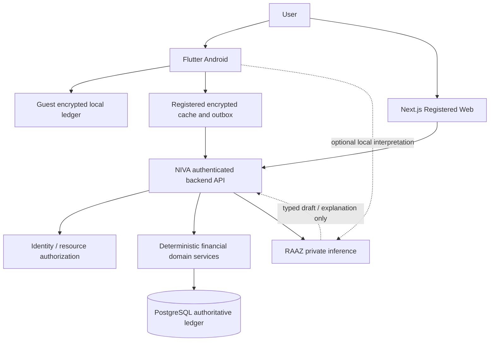

<div align="center">


# NIVA — Neural Intelligent Virtual Assistant

### Your Money. Your Intelligence. Your Future.

**A local-first, privacy-conscious financial management platform for individuals, households, and small businesses — powered by RAAZ, NIVA's independently developed financial ML companion.**

[Project Overview](#project-overview) · [Features](#features) · [Technology Stack](#technology-stack) · [Getting Started](#getting-started) · [Architecture](#system-architecture) · [Privacy](#privacy-and-security)


</div>

> [!IMPORTANT]
> **Development status:** NIVA is currently in planning and repository-initialization stages. The applications, backend ledger, sync system, and RAAZ ML models are **not yet built or production-ready**. This README describes the product vision and approved design direction, not capabilities available today.

> [!NOTE]
> The centered symbol above is the currently committed SVG **brand interpretation**, not a pixel-identical reproduction of the separately approved metallic logo. The exact official logo/app icons will be added once reviewed and imported into the repository.

---

## Project Overview

**NIVA (Neural Intelligent Virtual Assistant)** is a personal finance companion designed to help people understand where their money comes from, where it is held, how it is spent, what is owed, and what they can reasonably plan for the future.

Financial activity often lives in different places: bank accounts, cash, UPI apps, receipts, messages, household budgets, or small-business notebooks. NIVA aims to bring these **recorded financial activities** into one accessible, well-structured experience while respecting account ownership and personal privacy.

At the center of NIVA is **RAAZ**, an integrated assistant designed to interpret everyday financial requests in English, Tamil, and Tanglish. RAAZ prepares structured suggestions and explains data returned by NIVA's deterministic financial services; it does **not** independently decide balances, authorize transactions, or record financial entries.

### Project identity

| Property | Details |
|---|---|
| **Project name** | NIVA |
| **Full name** | Neural Intelligent Virtual Assistant |
| **Tagline** | Your Money. Your Intelligence. Your Future. |
| **Category** | AI-powered personal, household, and small-business financial management |
| **Assistant** | RAAZ — independently trained financial machine-learning system |
| **Architecture** | Local-first, privacy-focused, offline-capable, securely synchronized |
| **Platform sequence** | Android (Flutter) → Web (Next.js) → iOS (Flutter) |
| **Financial role** | User-directed recordkeeping and financial understanding — not banking execution |
| **Current phase** | Requirements, architecture, UI/UX and repository foundation; implementation pending |

## The Problem NIVA Addresses

People often struggle to obtain a complete and dependable view of their financial activity when money is spread across multiple accounts, payment applications, personal responsibilities, shared expenses, and small-business operations.

Common pain points include inaccurate or forgotten entries, duplicate transfer records, confusion between money received and money expected, repayments that are not linked to the original debt, household spending mixed with personal finances, and shop sales confused with cash collections or profit.

NIVA's goal is to provide **clearer financial records, trustworthy account-wise calculations, practical planning tools, and approachable conversational assistance**, without making essential functionality depend on a remote AI service.

## Who NIVA Is For

| User profile | Designed experiences |
|---|---|
| **Students** | Pocket money, irregular earnings, daily spending, shared bills, savings |
| **Working professionals** | Salary, multiple accounts, commitments, budgets, repayments |
| **Household finance managers** | Authorized family contributions, shared expenses, bills, privacy |
| **Small shopkeepers** | Sales, customer credit, suppliers, payments, inventory, financial reports |

**Eligibility:** Student Mode is planned for ages **15–22**, but access for users aged **15–17** remains disabled in both Guest and Registered Modes unless separate legal, age-assurance, guardian-consent, and safety requirements are approved. The initial release is intended for eligible adults (18+).

---

## What Is NIVA?

NIVA is planned as **one product with multiple experiences**:

### Guest Mode — Private and Local

Guest Mode is intended for eligible users who want to maintain **personal financial records on their device without registering an online NIVA identity**.

- Local accounts, income, expenses, budgets, goals, and settlements.
- Encrypted local financial database as the Guest source of truth.
- Supported offline finance workflows and deterministic calculations.
- No automatic upload of Guest financial records or conversations.
- User-initiated encrypted backup, restore, or migration.
- No server-backed recovery for records never uploaded.
- Shared Household and Business workspaces are **not** part of initial Guest scope.

### Registered Mode — Connected and Authorized

Registered Mode adds authenticated services and a **server-authoritative financial ledger** for synchronized records.

- Secure sign-in and authorized Personal, Household, and Business workspaces.
- Encrypted local data for supported offline activities.
- Pending operations synchronized after connectivity returns.
- Conflict-aware and idempotent financial synchronization.
- Server-backed recovery of successfully acknowledged records.
- Authorized device, session, sharing, and export controls.

Locally saved pending changes are **provisional** until accepted by the server. NIVA must not label a manually calculated bank amount as a live, bank-verified balance.

---

## Features

The features below represent **planned product scope**. Availability depends on implementation phases, authorization, connectivity, and testing.

### 1. Money Accounts & Financial Activity
- Register multiple bank, cash, and supported stored-value accounts.
- Record income, expenses, transfers, refunds, and adjustments.
- Track account-wise history, categories, and reference descriptions.
- Map UPI apps such as Google Pay and PhonePe to their underlying funding accounts when appropriate.
- Reconcile recorded balances against user-confirmed balances.
- Preserve corrections and history through linked audit-friendly events.

### 2. Budgets, Savings & Commitments
- Set budget limits and inspect category spending.
- Create savings goals and track allocations.
- Track due bills, recurring commitments, and EMI-related obligations.
- Distinguish **reserved money** from actual money transferred or spent.
- Provide financial planning guidance based on known records and clearly identified assumptions.

### 3. People, Split Expenses & Settlements
- Record **who paid the original bill** and who participated.
- Assign equal or custom shares to each person.
- Track **Paid**, **Partially Paid**, **Unpaid**, and **Settled** states.
- View each person's amount owed, repayment dates, methods, and remaining balance.
- Support partial repayments and linked settlement history.
- Use RAAZ to prepare split or repayment records through one conversation, with confirmation.

**Example:** One person records a ₹1,200 meal for four people, including themselves. Their share is ₹300; the other three collectively owe ₹900. When a friend repays ₹300, the outstanding receivable becomes ₹600. The repayment is linked to the original split, **not counted as new income**.

### 4. Personal, Household & Business Workspaces
- **Personal:** accounts, spending, goals, loans, settlements.
- **Household:** authorized shared expenses, bills, contributions, members, budgets.
- **Business:** sales, customer receivables, supplier obligations, purchases, inventory, reports.
- Enforce workspace and real-account ownership independently.
- Maintain **one authoritative recorded balance per distinct real account within its ownership scope**.

### 5. RAAZ — Financial Intelligence
- Interpret common financial questions and requests.
- Identify intents and financial fields such as amount, account, date, person, and category.
- Suggest transactions, summaries, and explanations.
- Ask clarifying questions when information is missing or uncertain.
- Support evaluated English, Tamil, and Tanglish use cases.
- Respect configurable Low / Medium / High assistance levels without changing financial permissions.
- Fall back to conventional finance screens when an ML capability is unavailable.

**Training direction:** RAAZ's core ML models are planned to be **trained from random initialization on project-controlled, approved datasets** using Python, PyTorch, and scikit-learn. No pretrained foundation-model weights or external hosted AI inference APIs are part of this baseline. Initial capabilities focus on financial intent recognition, slot extraction, classification, and controlled dialogue, **not unrestricted general-purpose chatbot performance**.

### 6. Reports, Documents & Data Control
- Financial summaries and transaction history.
- Owner/workspace-scoped reports and authorized exports.
- Receipt attachment and later custom OCR research.
- Encrypted Guest backup/restore with realistic recovery disclosures.
- Account/session management, app lock, privacy-conscious notifications, and data controls.
- Future speech/OCR and live bank integrations only after separate evaluation and approval.

### Recording Is Not Sending Money

> [!CAUTION]
> **NIVA does not execute real bank or UPI payments in its initial release.** “Record Transfer,” “Record Payment,” and “Record Settlement” mean saving a reference of an activity reported by the user. They do **not** send funds, settle obligations at a bank, or independently verify payment completion. Real bank transfer integrations are a **future possibility**, subject to legal, technical, security, and explicit consent approvals.

---

## Technology Stack

| Layer | Planned technology | Notes |
|---|---|---|
| Android app | **Flutter + Dart** | Primary delivery target |
| Flutter state / navigation | **Riverpod + go_router** | Feature-oriented client architecture |
| Local persistence | **SQLite + Drift** | Compatible encryption and key lifecycle to be validated |
| Web application | **Next.js + React + TypeScript** | Registered user access; later delivery |
| iOS application | **Flutter + Dart** | Planned after Web |
| Backend | **Node.js + TypeScript + Express** | NIVA-owned APIs and deterministic services |
| API validation / contract | **Zod + OpenAPI** | Versioned endpoints and shared contracts |
| Financial database | **PostgreSQL** | Registered authoritative journal and read models |
| Registered identity | **Firebase Authentication** | Identity only; NIVA enforces financial authorization |
| RAAZ ML | **Python + PyTorch + scikit-learn** | Custom data, training, evaluation, inference |
| Automation / CI | **GitHub Actions** | Checks and implementation pipelines over time |
| Source control | **Git + GitHub** | Initial monorepo |
| Hosting | **Not finalized** | Region, cost, backup, availability, and security review pending |

Libraries are development tools and do not imply reliance on pretrained third-party AI intelligence.

---

## System Architecture



**Architectural rule:** NIVA validates, calculates, authorizes, and records the financial truth. RAAZ helps users understand and prepare actions without bypassing those services. In Guest Mode, any approved on-device inference must preserve the no-cloud-financial-data boundary.

### Key financial invariants
1. Record money using exact currency-aware minor units, not floating-point ledger balances.
2. A real financial account has only one authoritative recorded balance within its proper ownership scope.
3. Transfers between one's own accounts do **not** create income.
4. Workspace classifications and savings earmarks do **not** create fictitious bank movements.
5. A collection against a receivable does **not** duplicate sales revenue.
6. Retries, migration, and offline reconciliation must not duplicate committed postings.
7. Accepted financial corrections must remain traceable.
8. The UI must distinguish draft, locally saved, pending synchronization, server accepted, and externally verified states.

---

## Getting Started

### 1. Clone the repository

```bash
git clone https://github.com/saikriz898/NIVA-Neural-Intelligent-Virtual-Assistant.git
cd NIVA-Neural-Intelligent-Virtual-Assistant
```

### 2. Explore the documentation and project boundaries

Read these first:

- [Architecture overview](docs/architecture/OVERVIEW.md)
- [Architecture decisions](docs/architecture/DECISIONS.md)
- [Initialization roadmap](docs/roadmap/INITIALIZATION.md)
- [Security baseline](docs/security/SECURITY_BASELINE.md)
- [UI/UX screen map](docs/ux/SCREEN_MAP.md)
- [Brand guide](assets/branding/BRAND_GUIDE.md)

### 3. Prepare development tools (when implementation begins)

Recommended environments:
- Flutter SDK and Android SDK for `apps/mobile/`.
- Node.js, npm and TypeScript for `apps/web/` and `services/api/`.
- PostgreSQL for the Registered backend.
- Python and a controlled virtual environment for `ml/raaz/`.

Use supported, pinned tool versions specified in the individual application manifests **after those projects are scaffolded**.

### 4. Configuration

The repository includes [`.env.example`](.env.example) with placeholder variable names only. Create local environment-specific configuration when each service is implemented. **Never commit real credentials**, especially Firebase service credentials, production PostgreSQL URLs, financial records, or model training secrets.

### 5. Current runnable status

**There is no valid `flutter run`, `npm run dev`, or model-training command for the complete NIVA project yet.** The initial directories currently contain design documents and README files, not scaffolded applications. The next milestone is to bootstrap each application and add verified run/test instructions here.

---

## Repository Structure

```text
NIVA-Neural-Intelligent-Virtual-Assistant/
├── apps/
│   ├── mobile/                 # Flutter Android-first, iOS later
│   └── web/                    # Next.js registered web experience
├── services/
│   └── api/                    # Node.js / Express backend
├── ml/
│   └── raaz/                   # Own-trained ML datasets, models, evaluation
├── contracts/
│   ├── openapi/                # Planned NIVA-owned API schemas
│   └── financial-events/      # Canonical finance events/test fixtures
├── docs/
│   ├── architecture/          # Overview and decision register
│   ├── prd/                   # Product requirements index
│   ├── trd/                   # Technical requirements index
│   ├── lld/                   # Low-level design index
│   ├── ux/                    # Screen map / user journeys
│   ├── security/              # Security design and safeguards
│   └── roadmap/               # Initialization tasks and milestones
├── assets/
│   └── branding/              # Palette, CSS variables and SVG interpretation
├── .github/
│   ├── workflows/             # Repository hygiene checks
│   └── ISSUE_TEMPLATE/        # Issue templates
├── .editorconfig
├── .env.example
├── .gitignore
├── CONTRIBUTING.md
├── SECURITY.md
└── README.md
```

The PRD/TRD/LLD indexes are committed; complete approved documents are **not yet imported** into this public repository.

---

## Design & Branding

<div align="center">


**Premium · Minimal · Intelligent · Trustworthy · Private**

</div>

| Color token | HEX | Meaning |
|---|---|---|
| Midnight | `#081729` | Dark background |
| Deep Navy | `#082D6B` | Strong brand surface |
| Electric Cyan | `#00AFFF` | Accent |
| Teal | `#00D6A3` | Secondary accent |
| Platinum | `#C6CDD8` | Neutral |
| Porcelain | `#F7F8FA` | Light background |

Primary font direction: **Inter**; optional secondary: **Plus Jakarta Sans**. See the [brand guide](assets/branding/BRAND_GUIDE.md). Splash screens are intentionally excluded from the brand-asset scope.

Mobile primary navigation: **Home · Activity · RAAZ · Plans · You**. The public website and authenticated web dashboard use separate navigation structures.

---

## Development Roadmap

| Phase | Scope | Current status |
|---|---|---|
| 0. Planning & branding | Problem definition, PRD/TRD/LLD, UI concepts, repository foundation | Documentation prepared; review and asset import pending |
| 1. Android Guest foundation | Local encryption, accounts, accurate transactions, transfers, history, basic plans | Not implemented |
| 2. Registered foundation | Identity, PostgreSQL ledger, guest migration, synchronization, recovery | Not implemented |
| 3. Workspaces | Authorized Personal/Household/Business foundations and sharing rules | Not implemented |
| 4. Web | Next.js Registered finance experience | Not implemented |
| 5. Expanded intelligence | RAAZ model training/inference, multilingual evaluation, advanced finance and inventory | Not implemented |
| 6. iOS & expansion | iOS-specific validation, release controls, further integrations | Not implemented |

RAAZ dataset preparation and training research may progress independently while the deterministic financial engine is being built.

---

## Privacy and Security

NIVA is being designed around strict financial-data boundaries:

- **Guest privacy:** no silent upload of Guest financial records, attachments, conversations, or balances.
- **Registered authorization:** verify identity and separately authorize every account, workspace, report, document, and financial action.
- **Encrypted storage:** protect local financial databases, keys, attachments, backups, and permitted data in transit.
- **Truthful recovery:** Guest local-only data may be unrecoverable without a valid backup; Registered recovery covers successfully acknowledged server data, not unknown pending local events.
- **Safe AI:** no private finance records used for RAAZ training by default; inference receives only authorized context; model output cannot directly commit ledger changes.
- **Explicit corrections:** audited reversals or adjustments where applicable, without silent deletion of historical financial effects.
- **Eligibility:** no access for users aged 15–17 before separate legal and safety approval; Guest Mode is not a bypass.
- **No banking secrets:** NIVA will not request UPI PINs, OTPs or banking passwords to record manual transactions.

> [!WARNING]
> This is an **early-stage public repository**. Do not commit or attach real financial datasets, account numbers, transaction exports, customer records, credentials, local databases, encryption material, receipts, or private conversations.

Report vulnerabilities privately to the maintainer; do not disclose sensitive details in public issues. See [SECURITY.md](SECURITY.md).

## Contributing

Contributions should preserve NIVA's financial correctness, Guest privacy, server-side authorization, and RAAZ independence. New functionality must include requirements references, security impacts, negative test cases, and documented behavior for failure/offline conditions.

See [CONTRIBUTING.md](CONTRIBUTING.md), the [PR template](.github/PULL_REQUEST_TEMPLATE.md), and [GitHub Issues](https://github.com/saikriz898/NIVA-Neural-Intelligent-Virtual-Assistant/issues).

## License & Project Status

**No software license has been selected or granted for this repository yet.** Please do not assume permission to reuse, redistribute, or commercially incorporate the code/assets merely because the repository is publicly visible. A license and asset-rights review is required before an open-source release.

Product, design and technical directions may evolve as engineering validation proceeds. All service, deployment, and model availability claims are intentionally marked as planned until implemented and tested.

---

<div align="center">

### NIVA — Neural Intelligent Virtual Assistant

**Your Money. Your Intelligence. Your Future.**

*Financial truth belongs to NIVA. RAAZ makes that truth easier to understand and use.*

[Back to Top](#niva--neural-intelligent-virtual-assistant)

</div>
