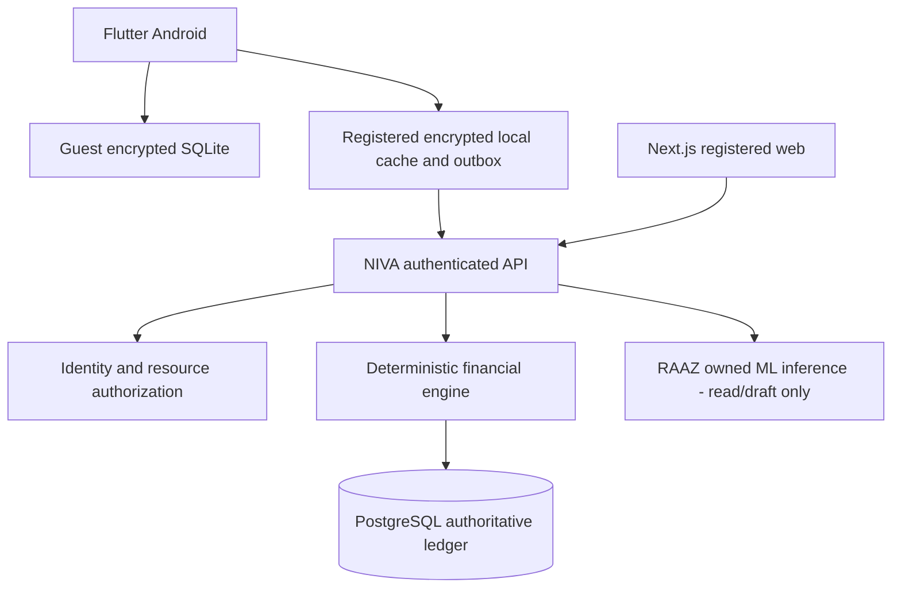

# NIVA Architecture Overview

**Scope:** Planning baseline, not implemented software.

Guest personal finance data remains on device unless explicitly exported or migrated. Registered Mode uses backend-accepted ledger events as authoritative and displays offline events as provisional.

Each distinct real money account has a single recorded balance within its legal ownership scope. Workspaces classify permitted transactions but never duplicate money balances.

RAAZ understands requests and prepares drafts; it cannot post accounting entries without user confirmation and NIVA validation.

**Platforms:** Flutter Android first; Next.js registered web; Flutter iOS later. **No live payment execution** initially.
